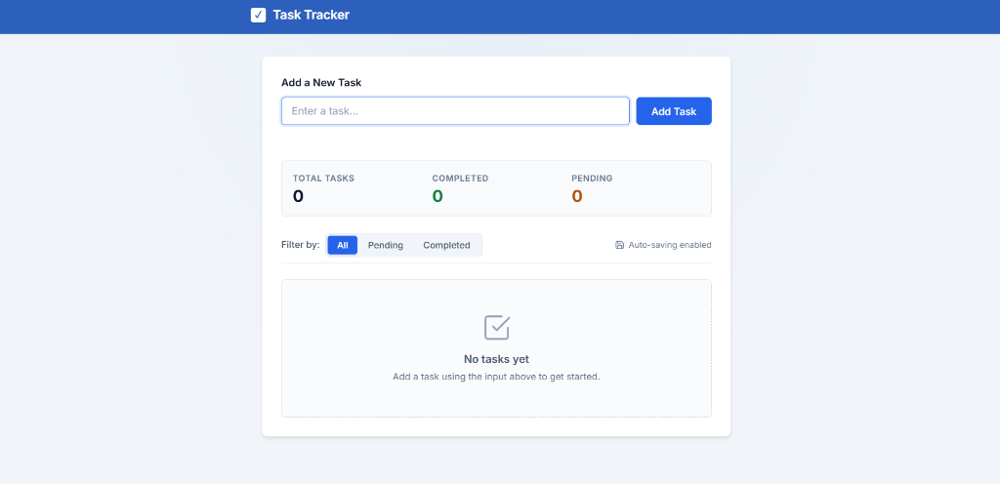
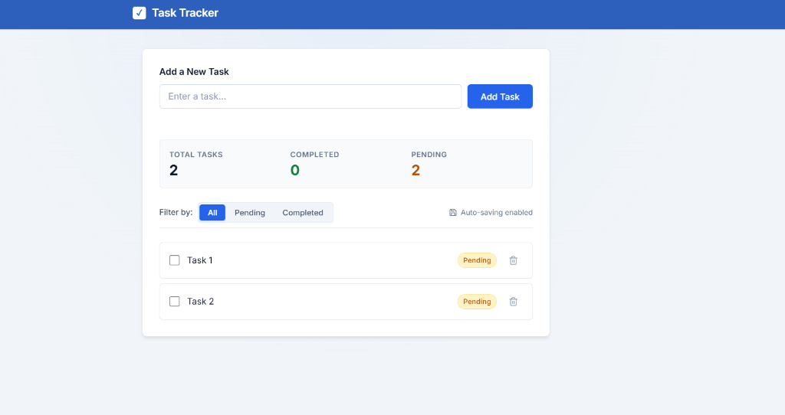
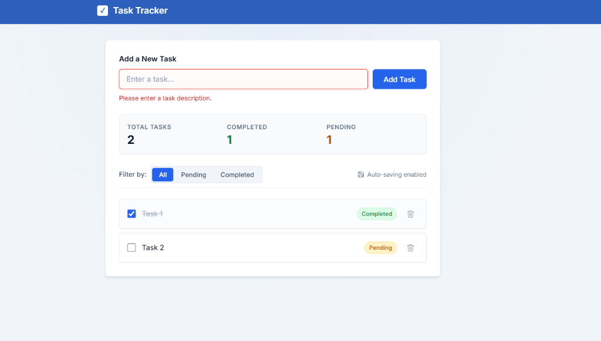
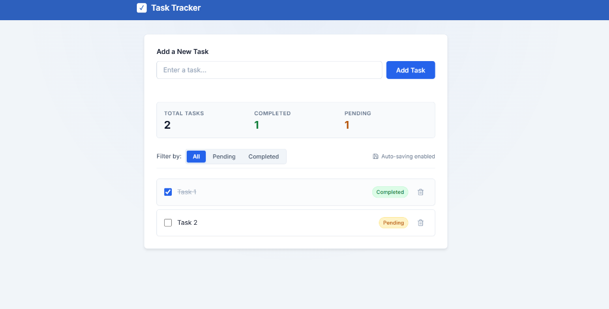
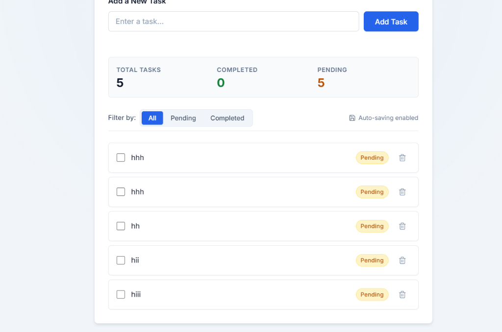

# 📋 Task Tracker — JTRONIX

[](https://react.dev/)
[](https://vitejs.dev/)
[](https://developer.mozilla.org/en-US/docs/Web/CSS)
[](LICENSE)

A modern, responsive, and accessible task management web application engineered for the **JTRONIX Frontend Internship Assessment**. Built from the ground up using **React 19**, **Vite**, and **Vanilla CSS3**, featuring real-time client-side persistence, smooth micro-interactions, dynamic status filtering, and comprehensive validation.

---

## 📸 Interface & Feature Highlights

### 1. Clean Empty State
When you first launch the app or clear all tasks, an intuitive empty state greets you, inviting you to add your first item.


> **Figure 1**: Responsive card layout displaying the zero-state prompt and empty counter indicators.

---

### 2. Main Dashboard & Live Statistics
Track your daily workload with real-time metric cards that automatically compute **Total Tasks**, **Completed**, and **Pending** counts, with an auto-save confirmation badge.


> **Figure 2**: Dashboard displaying active pending tasks, real-time metrics, filter pill buttons, and auto-save indicator.

---

### 3. Smart Input Validation
Prevents empty submissions and duplicate task titles (case-insensitive) with instant inline error alerts and accessible feedback.


> **Figure 3**: Clear validation feedback highlighting the input field with assistive error text upon submitting invalid data.

---

### 4. Interactive Task Completion
Toggle any task's state with a single click or keyboard trigger. Completed tasks display a clean strikethrough, muted typography, and an emerald `Completed` status badge.


> **Figure 4**: Visual distinction between Pending (amber) and Completed (emerald) tasks, instantly updating live counters.

---

### 5. Task Queue & Action Controls
Manage multiple tasks effortlessly. Each task item includes subtle hover elevation, left-accent indicators, and a one-click delete button with smooth exit motion.


> **Figure 5**: Vertical task stream with responsive spacing, custom checkboxes, and delete actions.

---

## ⚡ Core Features

- 📝 **Task Creation**: Fast and seamless task entry with immediate UI updates.
- 🛡️ **Validation & Duplicate Protection**: Validates input length and prevents identical tasks (case-insensitive).
- 🏷️ **Dynamic Status Badging**: Visual status indicators (`Pending` in amber, `Completed` in emerald).
- 🔍 **Filter Views**: Switch views instantly between **All**, **Pending**, and **Completed** with active status indicators.
- 📊 **Real-time Statistics**: Metrics summary bar calculating total volume, pending count, and completed count.
- 💾 **Local Storage Persistence**: Automatic synchronization to browser `localStorage` ensuring data persists across reloads.
- 🎬 **Refined Motion & Animations**:
  - Slide-up entrance animation for newly added tasks.
  - Slide & collapse exit transition on task deletion.
  - Interactive hover elevation and rightward micro-shift.
- ♿ **Accessibility First**: Semantic HTML5, full keyboard navigation (Tab, Enter, Space), and ARIA-compliant labels.
- 📱 **Fully Responsive**: Mobile-first architecture that seamlessly adapts from phones to large desktop screens.

---

## 🚀 How to Run This Project Locally

Follow these step-by-step instructions to clone and run the application on your machine:

### 1. Prerequisites
Ensure you have **Node.js** installed (version 18.x or later recommended):
```bash
node -v
npm -v
```

### 2. Clone the Repository
```bash
git clone https://github.com/Vipulpadwal15/Task-Tracker.git
cd Task-Tracker
```

### 3. Install Dependencies
Install all required project dependencies:
```bash
npm install
```

### 4. Start the Development Server
Launch the Vite development server with Hot Module Replacement (HMR):
```bash
npm run dev
```

Once running, open your web browser and navigate to:
```
http://localhost:5173
```
*(If port 5173 is occupied, Vite will automatically assign the next available port, e.g., `http://localhost:5174`)*

---

## 🛠️ Other Available Scripts

| Command | Description |
| :--- | :--- |
| `npm run dev` | Starts local development server with instant HMR |
| `npm run build` | Bundles and minifies application assets for production into `/dist` |
| `npm run preview` | Serves the production build locally to test performance |
| `npm run lint` | Runs Oxlint to inspect code quality and React best practices |

---

## 📂 Project Architecture

```
Task-Tracker/
├── public/
│   └── favicon.svg           # Application favicon
├── screenshots/              # Project demonstration screenshots
│   ├── 01-empty-state.png
│   ├── 02-task-overview.png
│   ├── 03-input-validation.png
│   ├── 04-task-completion.png
│   └── 05-multi-task-list.png
├── src/
│   ├── App.css               # Design system, layout, animations & responsive rules
│   ├── App.jsx               # Main React component, state management & handlers
│   ├── index.css             # Base reset, typography & CSS variables
│   └── main.jsx              # Application bootstrap & DOM entry point
├── .gitignore                # Git ignore patterns (node_modules, dist, logs)
├── .oxlintrc.json            # Oxlint configuration
├── index.html                # HTML5 shell & Google Fonts integration
├── package.json              # Project dependencies & npm scripts
├── README.md                 # Project documentation & guide
└── vite.config.js            # Vite configuration & React plugin
```

---

## 🎨 Design System

- **Primary Accent**: Royal Blue (`#2563eb`)
- **Background**: Soft cool gray gradient (`#f1f5f9` to `#e2e8f0`)
- **Card Surfaces**: Pure white (`#ffffff`) with subtle border borders (`#e2e8f0`)
- **Status Badges**:
  - Pending: Amber tint (`#fef3c7` / `#b45309`)
  - Completed: Emerald tint (`#dcfce7` / `#15803d`)
- **Typography**: [Inter](https://fonts.google.com/specimen/Inter) via Google Fonts

---

## 👤 Author

**Vipul Padwal**  
GitHub: [@Vipulpadwal15](https://github.com/Vipulpadwal15)  
Repository: [Task-Tracker](https://github.com/Vipulpadwal15/Task-Tracker)
